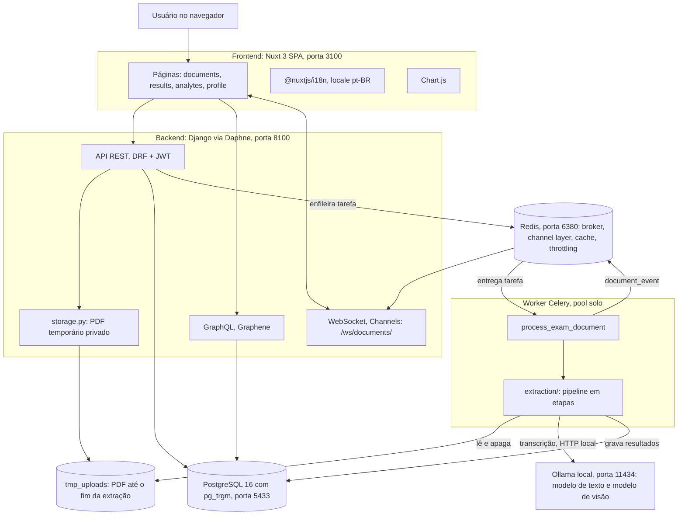
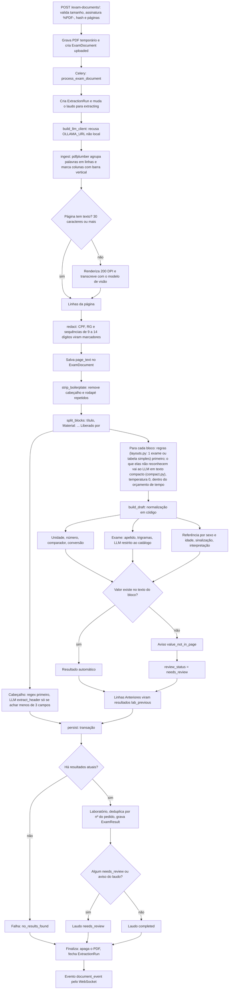
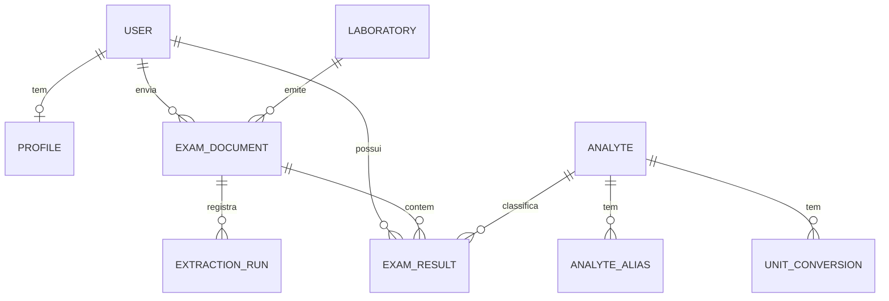

# Arquitetura do MyExams

Visão técnica do fluxo de dados e das decisões de projeto. Para subir o projeto, veja o
[`README.md`](../README.md). O desenho abaixo é o do desenvolvimento local; a variante de nuvem (Vercel + Neon, leitura
dentro da requisição, sem worker, Redis nem WebSocket) está em [`DEPLOY.md`](DEPLOY.md).

## Componentes

Pontos que o diagrama resume:

- **O navegador só fala com a API.** O PDF vai por `multipart/form-data` para
  `POST /api/v1/exam-documents/`; a resposta é `202` e o resto acontece no worker.
- **O worker é o único processo que fala com o Ollama** (`OllamaClient`, que recusa hosts
  não locais).
- **O Redis cumpre quatro papéis**: broker do Celery, camada de canais do WebSocket, cache
  e contadores de throttling do DRF.
- **O estado do laudo** (`uploaded` -> `extracting` -> `completed`, `needs_review` ou
  `failed`) vai para o frontend por WebSocket (`document_event`); o frontend recarrega os
  dados quando recebe um status final.

## Pipeline de extração

Reprocessar entra no fluxo em `L`: `process_document` pula `ingest` e reconstrói as
páginas a partir de `ExamDocument.page_text`, o que dispensa o PDF.

### Papel de cada etapa

| Etapa | Módulo | Determinística? |
|---|---|---|
| Leitura do PDF, colunas, redação de CPF/RG | `linearize.py` | Sim (a transcrição de páginas escaneadas usa o modelo de visão) |
| Remoção de cabeçalho/rodapé e blocos | `blocks.py` | Sim |
| Cabeçalho do laudo | `pipeline.py` (+ `llm.py`) | Regex primeiro; o LLM só entra se o regex achar menos de 3 dos 5 campos (e completa os vazios) |
| Linhas de resultado de blocos com 1 exame | `layouts.py` (regras) | Sem LLM; a referência é copiada pelo código |
| Linhas de resultado de tabelas simples (`NOME \| VALOR \| UNIDADE \| REFERÊNCIA`, hemograma com percentual + absoluto) | `layouts.py` (regras de tabela) | Sem LLM; na dúvida, o bloco inteiro vai ao LLM (nunca meia tabela) |
| Linhas de resultado dos demais blocos | `llm.py` + `compact.py` | **Só aqui o LLM decide o que ler** (resposta curta em texto), limitado por `EXTRACTION_LLM_BUDGET_SECONDS`: estourado o teto, o resto é pulado com `block_unreadable` (um por bloco: página + nome do exame) + `llm_budget_exceeded` |
| Números, comparadores e ponto/vírgula | `numbers.py` | Sim |
| Unidades e conversões | `units.py` | Sim |
| Faixas de referência (sexo, idade, rótulos) | `reference.py` | Sim |
| Sinalização `low`/`normal`/`high`/`abnormal` | `flags.py` | Sim |
| Resolução do exame | `analytes.py` | Apelido e trigramas sim, LLM só como último recurso e restrito ao catálogo |
| Checagens (aterramento, plausibilidade, nome do paciente) | `validate.py` | Sim |
| Recálculo após edição do usuário | `recompute.py` | Sim, sem LLM |

### Garantias

- **O LLM só transcreve.** O prompt exige copiar valor, unidade e referência como
  impressos, em texto. Nada é convertido, corrigido ou calculado pelo modelo.
- **Aterramento (grounding).** O valor devolvido pelo modelo precisa aparecer no texto do
  bloco; senão o resultado ganha `value_not_in_page` e vai para revisão. Valor vazio vira
  `value_missing`. Em nenhum caso a linha é descartada.
- **Sem exame mapeado, o resultado é salvo mesmo assim** (`unmapped_analyte`), com
  `analyte = NULL`, para o usuário atribuir um exame depois. Essa atribuição vira um
  apelido (`AliasSource.USER`).
- **Idempotência.** A tarefa pode rodar de novo: os resultados do laudo são substituídos
  dentro de uma transação, e resultados `lab_previous` já semeados por outro laudo para o
  mesmo exame e dia são substituídos pelo resultado atual.
- **PDF apagado no `finally`** da tarefa, com sucesso ou falha.

## Modelo de dados

`Analyte`, `AnalyteAlias`, `UnitConversion` e `Laboratory` são **globais**; todo o resto
pertence a um usuário e é filtrado por ele em cada consulta.

## O que mudou em relação ao `myfinances`

| Tema | `myfinances` | `myexams` |
|---|---|---|
| Fonte de dados | Pluggy (Meu Pluggy), webhook, instituições, contas, cartões | **Removidos.** A fonte é o PDF enviado pelo usuário |
| Dados de mercado, assinaturas, metas, categorização | Presentes | **Removidos** (sem equivalente no domínio de exames) |
| Busca semântica | `pgvector` + embeddings + RAG (relatório de portfólio) | **Removidos.** Resolução do exame por **`pg_trgm`** (similaridade de trigramas) sobre apelidos, com o LLM só como último recurso |
| Papel do LLM | Gera relatório a partir de contexto recuperado | **Só transcreve** texto de laudo; números, unidades, faixas e sinalização são código |
| Arquivos | Não trata upload | **Upload de PDF**: armazenamento privado e temporário, hash, validação de tipo/tamanho/páginas, leitura com `pdfplumber`, modelo de visão para páginas escaneadas, PDF apagado ao fim |
| Tarefas periódicas | Celery beat (snapshots e reconciliação diárias) | **Sem beat.** Só a tarefa `process_exam_document` |
| Worker Celery | Pool padrão | `--pool=solo`: uma extração por vez, evita o pool prefork/spawn do macOS |
| Evento de WebSocket | `sync_event` | **`document_event`** (`status` e `document_id`, endpoint `ws/documents/`) |
| GraphQL | Presente | **Mantido** (visão geral e histórico por exame); laudos, resultados e perfil usam REST |
| Frontend: i18n | Texto direto nos componentes | **`@nuxtjs/i18n`** com `locales/pt-BR.json`, ESLint `@intlify` e backend devolvendo só códigos |
| Ícones | `@iconify/vue` sem coleção embutida (busca remota em tempo de execução) | Coleção `mdi` embutida (`bun run icons`), sem chamada de rede |
| Portas | API 8000, web 3000, db 5432, redis 6379 | **API 8100, web 3100, db 5433, redis 6380** |
| Postgres | Exige a extensão `pgvector` (dependência `pgvector` no backend) | `postgres:16-alpine` padrão: `pg_trgm` vem no contrib |
| Inferência | Ollama local (chat e embeddings) | Ollama local (modelo de texto e de visão), sem embeddings; mesma guarda `AI_ALLOW_REMOTE_INFERENCE` |
| `ty` | Regras padrão | Classes de regra desligadas em `backend/pyproject.toml` (`unresolved-attribute`, `invalid-assignment`, `invalid-argument-type` etc.), porque o `ty` não entende os campos do Django sem plugin. Nomes indefinidos e imports seguem checados |
| Privacidade | Dado financeiro local | Dado de saúde: redação de CPF/RG, PDF efêmero, nenhum valor em log, escopo por usuário em todo queryset |
| Registro público | Desligado por padrão | **Mantido** desligado por padrão (`DJANGO_ALLOW_PUBLIC_REGISTRATION=False`) |

## Decisões de projeto

- **App único** (`apps/exams`) com o pipeline em módulos pequenos por etapa, cada um com
  testes próprios. Cada etapa recebe e devolve dados simples, o que permite reprocessar
  sem o PDF.
- **Códigos em vez de texto no backend.** `ErrorCode`, `WarningCode` e os enums de status
  são o contrato com o frontend; `test_i18n_parity.py` mantém os dois lados sincronizados.
- **Autenticação por JWT** (`djangorestframework-simplejwt`, access de 60 minutos) em REST,
  GraphQL (`JWTGraphQLView`, que também isenta CSRF e devolve `401` para token inválido) e
  WebSocket (token na query string, recusa com código `4001`).
- **Throttling** por escopo: `login` (10/h) para token e registro, `upload` (30/h) porque
  cada envio dispara inferência pesada.
- **Limites do Celery**: `CELERY_TASK_TIME_LIMIT` de 60 minutos e
  `visibility_timeout` do Redis de 2 horas (maior que o limite da tarefa, para o Redis não
  reentregar uma extração longa que ainda está rodando).
